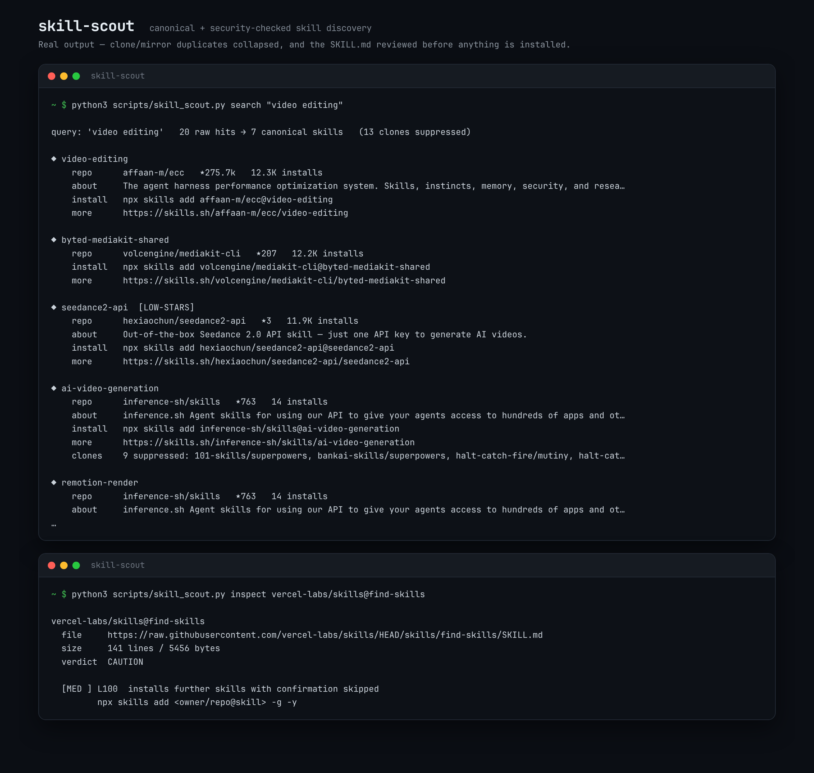

# skill-scout

**Clean, canonical, security-checked discovery for the open agent-skills registry.**

`skill-scout` is a small toolkit (one Python script + a skill definition) that sits
between you and `npx skills find`. It fixes the two things that make the public
skills registry risky to use raw: **clone pollution** in the rankings, and the
**absence of any security review** before a skill runs with full agent permissions.

No dependencies. Python 3.9+ and `npx` (Node) are all you need.



---

## Why this exists

### 1. The registry ranking is inflated by clones

The same skill is republished under dozens of owners, and *every copy reports the
same large install count*. Real search results for `video editing`:

| Repo | Installs shown | Real stars | Status |
|---|---|---|---|
| `101-skills/superpowers` | **710.6K** | 5 | copy |
| `qu-skills/superpowers` | 393.9K | 2 | copy |
| `magentosh/superpowers` | 371.5K | 1 | fork |
| `bankai-skills/superpowers` | 228.1K | 0 | fork |
| `obra/superpowers` | *(buried)* | **296,808** | original |

A skill ranked **#1 with "710K installs"** comes from a repository with **5 stars**.
If you trust the ranking, you install the wrong thing. `skill-scout` groups results
by skill name, resolves the original repo, and tells you how many clones it collapsed.

### 2. Nothing reads the skill before it runs

A skill is arbitrary instructions the agent follows **with full agent permissions**.
There is no sandbox. The registry shows a Gen/Socket/Snyk badge, but nothing reads
the `SKILL.md` for shell execution, credential access, exfiltration or
prompt-injection. `skill-scout inspect` does, with colour-coded severity.

---

## Install

```bash
git clone https://github.com/pusucip25/skill-scout.git
cd skill-scout

# optional: raise the GitHub API limit from 60 to 5000 requests/hour
export GITHUB_TOKEN=ghp_xxx
```

To use it as an agent skill, copy or symlink the folder into your agent's skills
directory (for Hermes: `~/.hermes/skills/skill-scout`).

---

## Usage

### Search — clones collapsed, canonical repo resolved

```bash
python3 scripts/skill_scout.py search "video editing"
```

```
query: 'video editing'   20 raw hits → 7 canonical skills   (13 clones suppressed)

◆ ai-video-generation
    repo      inference-sh/skills   ★763   14 installs
    about     inference.sh Agent skills for using our API to give your agents access to hundreds of apps
    install   npx skills add inference-sh/skills@ai-video-generation
    more      https://skills.sh/inference-sh/skills/ai-video-generation
    clones    9 suppressed: 101-skills/superpowers, bankai-skills/superpowers, halt-catch-fire/mutiny,
              halt-catch-fire/superpowers, its-a-skill-issue/superpowers, magentosh/superpowers,
              qu-skills/superpowers, skills-101/superpowers, skills-shell/superpowers
```

Options:

```bash
python3 scripts/skill_scout.py search "react performance" --owner vercel   # one owner only
python3 scripts/skill_scout.py search "seo audit" --json                   # machine-readable
python3 scripts/skill_scout.py search "video editing" --limit 5            # top N only
```

Flags on a result are warnings, not decoration:

| Flag | Meaning |
|---|---|
| `[FORK]` | The canonical pick is itself a fork of another repo |
| `[LOW-STARS]` | Under 100 stars — treat sceptically regardless of install count |
| `[ARCHIVED]` | Upstream repo is archived; prefer an active alternative |
| `[UNVERIFIED]` | GitHub metadata unavailable (rate limit) — count is not a quality signal |

### Inspect — security-review a SKILL.md before installing

```bash
python3 scripts/skill_scout.py inspect czlonkowski/n8n-skills@n8n-workflow-patterns
```

```
czlonkowski/n8n-skills@n8n-workflow-patterns
  file     https://raw.githubusercontent.com/czlonkowski/n8n-skills/HEAD/skills/n8n-workflow-patterns/SKILL.md
  size     549 lines / 20389 bytes
  verdict  CLEAN
```

```bash
python3 scripts/skill_scout.py inspect vercel-labs/skills@find-skills
```

```
vercel-labs/skills@find-skills
  file     https://raw.githubusercontent.com/vercel-labs/skills/HEAD/skills/find-skills/SKILL.md
  size     141 lines / 5456 bytes
  verdict  CAUTION

  [MED ] L100  installs further skills with confirmation skipped
         npx skills add <owner/repo@skill> -g -y
```

Verdicts: **CLEAN** (no matches) · **CAUTION** (MED findings) · **REVIEW REQUIRED** (HIGH findings).

### Domains — curated query bundles

```bash
python3 scripts/skill_scout.py domains
```

```
video        video editing | ai video | image to video | video generation | remotion
media        image generation | ai music | audio | tts | subtitle
automation   n8n | workflow automation | zapier | make automation | webhook
social       twitter automation | linkedin | instagram | tiktok | reddit automation
marketing    seo audit | copywriting | landing page | email marketing | analytics
```

---

## What `inspect` detects

| Severity | Patterns |
|---|---|
| **HIGH** | `curl … \| bash`; `rm -rf /`, `mkfs`, raw `dd` to a device; reads of `~/.ssh`, `id_rsa`, `.aws/credentials`, keychains; data exfiltration (`curl -X POST --data`, `nc`, `/dev/tcp`); prompt-injection / concealment ("ignore previous instructions", "do not tell the user") |
| **MED** | Secret references (`.env`, `API_KEY`, `TOKEN`); dynamic/encoded execution (`eval`, `exec`, `base64 -d`, `python -c`); `sudo`, `chmod +x`; auto-installing further skills with `-y` |
| **LOW** | References to external domains outside github/skills.sh |

Every rule is in one editable list (`RISK_RULES`) at the top of the scanner — add your own.

---

## The required workflow

1. **Search** → `skill-scout search`
2. **Read the flags** (fork / stars / archived / unverified / clones suppressed)
3. **Inspect** → `skill-scout inspect <owner/repo@skill>`
4. **Install only with explicit confirmation, scoped:**

```bash
npx skills add <owner/repo@skill> -g -a <agent> --copy
```

---

## Philosophy

- **Never install unprompted.** "Find me a skill" is a search request, not consent.
- **Never pass `-y` on an uninspected skill.**
- **Never recommend a skill you have not read.**
- **Report the clone count** — if the ranking was inflated, the user deserves to know.

---

## Limitations

- Canonicalisation is a **heuristic** (non-fork, most stars). It can misidentify the
  original when a mirror has been starred more heavily.
- `inspect` is a **pattern scanner**, not a proof of safety. `CLEAN` means "no
  known-bad patterns", not "trusted".
- Star/fork data comes from the unauthenticated GitHub API unless `GITHUB_TOKEN` is
  set; rows degrade to `[UNVERIFIED]` when rate-limited.
- The curated domain bundles are starting points, not exhaustive coverage.

---

## License

MIT — see [LICENSE](LICENSE).
